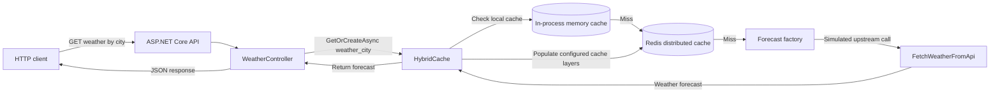
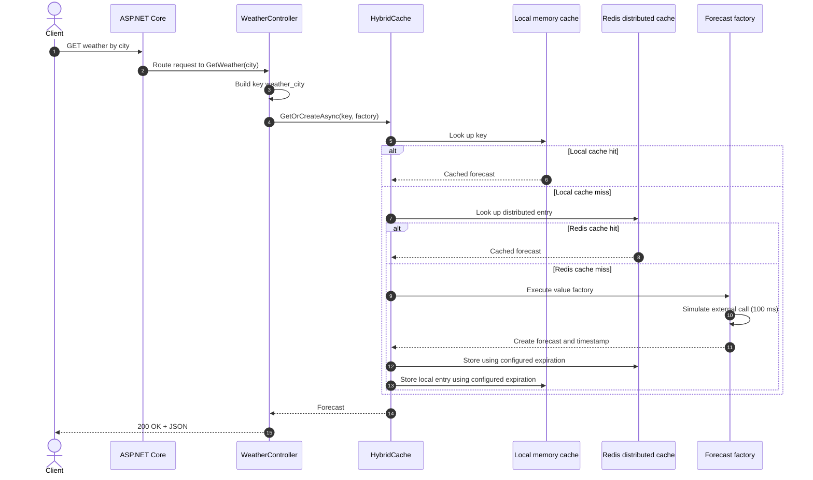

# HybridCache in .NET 9: Multi-Level Caching with Redis and ASP.NET Core


Explore **HybridCache in .NET 9** through a small **C# / ASP.NET Core Web API** sample. The app uses `HybridCache.GetOrCreateAsync` to retrieve a weather forecast by city, simulates a slower upstream API call when the value is not available in cache, and configures in-memory and Redis-backed caching through .NET's caching services.

This repository is a learning project demonstrating the HybridCache API and a cache-aside request flow. The weather source is simulated in code; it is not a real weather integration or a benchmark of cache performance.

## At a glance

- **Language and runtime:** C# / .NET 9
- **Web framework:** ASP.NET Core Web API
- **Caching API:** `Microsoft.Extensions.Caching.Hybrid` (`HybridCache`)
- **Distributed cache:** Redis via `Microsoft.Extensions.Caching.StackExchangeRedis`
- **Sample endpoint:** `GET /api/Weather/{city}`
- **Cache options:** 30-minute default and local expirations; 1 MiB maximum payload and 512-character maximum key

## Architecture and data flow

The controller builds a city-specific cache key and calls `GetOrCreateAsync`. HybridCache coordinates the cache lookup and factory; if no cached entry is available, the factory simulates fetching a forecast and the result is returned to the caller and cached according to the configured options. The application registers memory caching and Redis distributed caching as HybridCache's backing cache services.



> The repository configures memory and Redis cache services and uses `HybridCache`; the precise internal lookup and population details are managed by the .NET HybridCache implementation. The diagram describes the intended multi-level cache-aside flow, not custom cache-layer code in this project.

## Sequential request flow



## API example

### Get a forecast by city

```http
GET /api/Weather/London
Accept: application/json
```

The controller uses `weather_London` as the cache key. On a cache miss, `FetchWeatherFromApi` waits 100 milliseconds and generates a sample `WeatherForecast` with a random temperature and the summary `Sunny`. Repeated requests can use cached data until expiration; the sample does not call an actual weather provider.

## Benefits of HybridCache

HybridCache is designed to simplify caching in .NET applications by bringing together local and distributed cache behavior behind a unified API. Potential benefits include:

- **Fast repeated reads:** cached values can avoid repeating expensive data retrieval work.
- **Local and shared cache options:** combine process-local memory caching with a distributed cache such as Redis.
- **Simpler cache-aside code:** `GetOrCreateAsync` expresses lookup-or-create behavior without hand-writing the basic orchestration in every endpoint.
- **Reduced load on dependencies:** cache hits can reduce repeated requests to databases or upstream services.
- **Configurable cache behavior:** expiration and payload/key limits can be set for application needs.

Actual latency, hit rate, consistency, and scalability depend on workload, configuration, deployment topology, and the backing services. This sample does not include benchmarks or production observability.

## Example use cases

A similar caching pattern can be useful for:

- Frequently requested product, catalog, or inventory details.
- Weather, reference, or geospatial data retrieved from a slower upstream API.
- Read-heavy dashboards and summary endpoints.
- Configuration or metadata that changes infrequently but is accessed often.
- Multi-instance web applications that need a shared cache backend such as Redis.

Choose expiration and invalidation policies based on how stale data may safely become. Avoid caching sensitive data without reviewing security, isolation, and retention requirements.

## Run locally

### Prerequisites

- .NET 9 SDK
- Redis reachable from the application (the default configuration points to `localhost:6379`)

Start Redis locally with Docker if needed:

```bash
docker run --name hybridcache-redis -p 6379:6379 -d redis
```

Restore packages and start the API from the repository root:

```bash
dotnet restore
dotnet run
```

The Development launch profile uses `http://localhost:5114` (and HTTPS at `https://localhost:7100`). Swagger middleware is enabled in Development. Try the endpoint at:

```text
http://localhost:5114/api/Weather/London
```

The Redis connection is configured as `ConnectionStrings:Redis` in `appsettings.json`. Override it using environment-specific configuration where appropriate; do not put production credentials in source control.

## Configuration in this sample

`Program.cs` registers memory caching, Redis distributed caching, and HybridCache. It sets:

- `MaximumPayloadBytes`: 1 MiB
- `MaximumKeyLength`: 512 characters
- Default expiration: 30 minutes
- Local cache expiration: 30 minutes

The project currently references `Microsoft.Extensions.Caching.Hybrid` version `9.0.0-preview.7.24406.2`. Review the package version and its compatibility/support status before adopting this sample in a new or production project.

## Project structure

```text
Controllers/  Weather API endpoint and HybridCache usage
Models/       WeatherForecast response model
Program.cs    Memory, Redis, HybridCache, and API configuration
```

## Production considerations

This is a compact demonstration, not a production-ready caching strategy. Before using a similar design in production, consider:

- Replacing the simulated forecast factory with a real, resilient data provider.
- Defining cache invalidation and freshness requirements, not only time-to-live.
- Handling Redis connectivity, timeouts, and dependency failures intentionally.
- Avoiding cache keys that expose sensitive data and validating user-controlled key parts.
- Adding structured logging, metrics, tracing, and tests for hits, misses, expiration, and failures.
- Selecting stable package versions compatible with your target .NET release.

## Further reading

- [Microsoft.Extensions.Caching.Hybrid documentation](https://learn.microsoft.com/aspnet/core/performance/caching/hybrid)
- [ASP.NET Core caching overview](https://learn.microsoft.com/aspnet/core/performance/caching/overview)
- [Redis documentation](https://redis.io/docs/latest/)
- [Why HybridCache is the Future of Caching in .NET 9 — A Developer’s Guide](https://medium.com/asp-dotnet/why-hybridcache-is-the-future-of-caching-in-net-9-a-developers-guide-a5b3e3488906?sk=8aa61a5d51982e5b5d689c67b10dd78d)

---

**Search topics:** HybridCache .NET 9, C# HybridCache tutorial, ASP.NET Core caching, .NET distributed cache, Redis cache in .NET, Microsoft.Extensions.Caching.Hybrid, cache-aside pattern, multi-level caching, in-memory cache, web API performance.

> Search visibility cannot be guaranteed by README changes alone. Accurate documentation, useful examples, relevant repository topics, maintenance, and links from relevant sources can improve discoverability over time.
